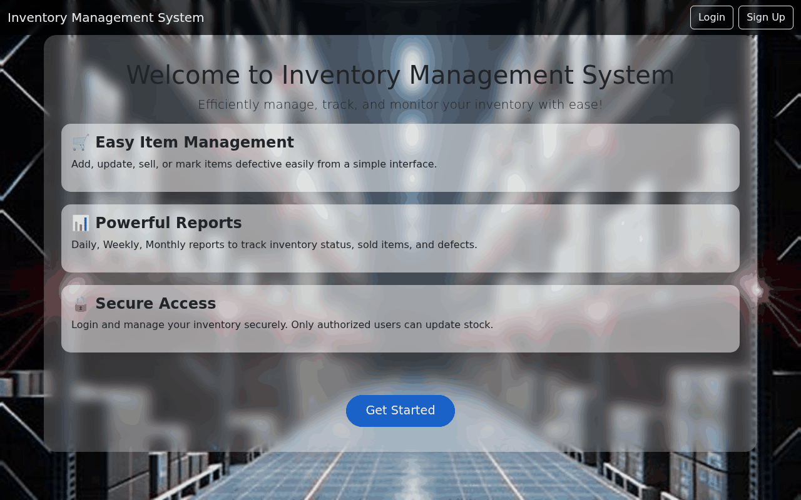
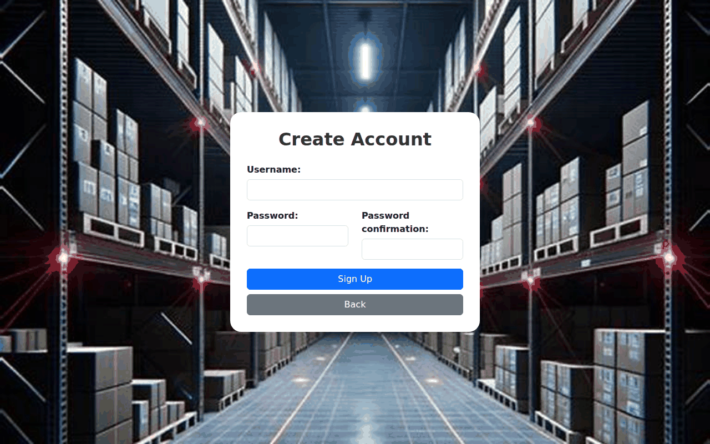
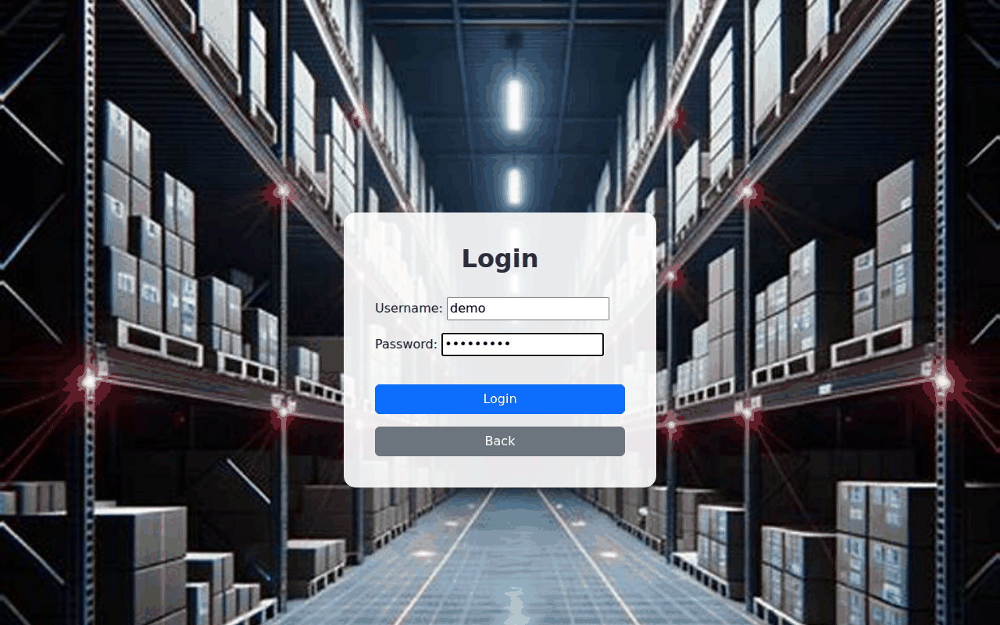
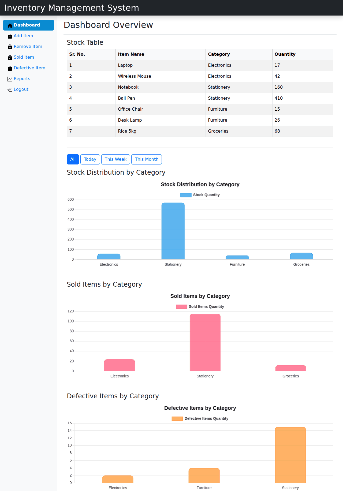
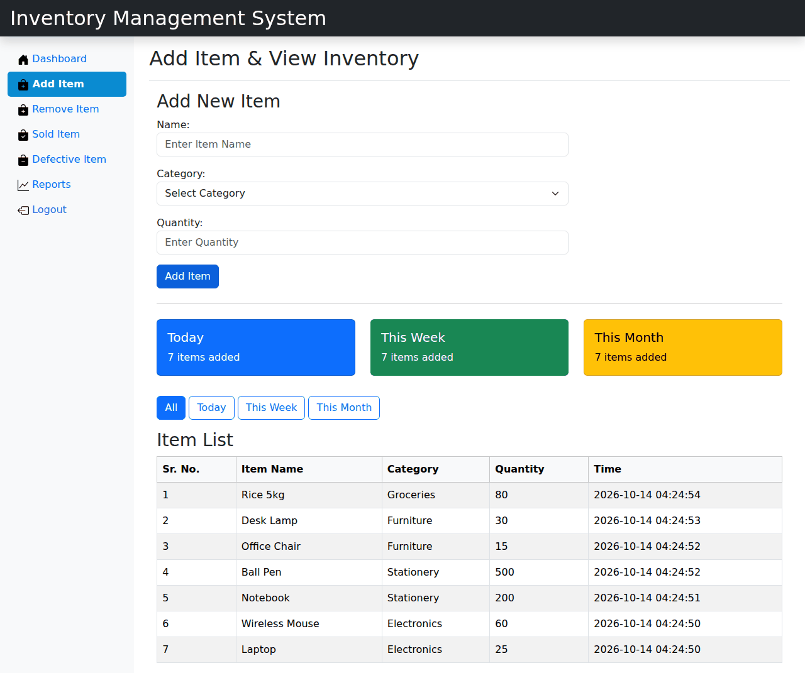
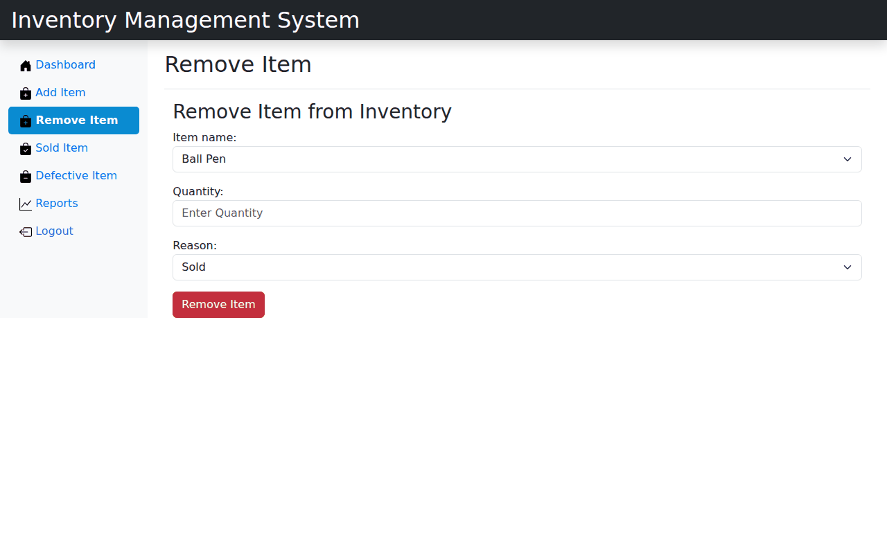
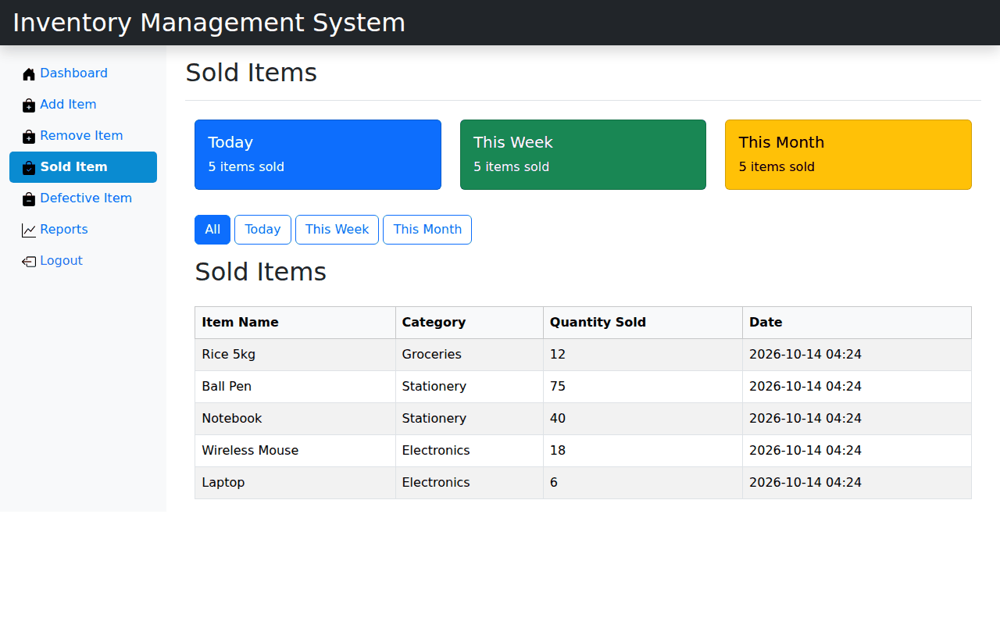
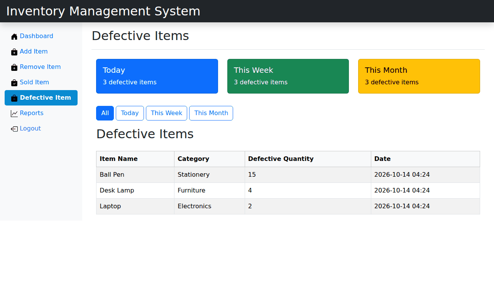
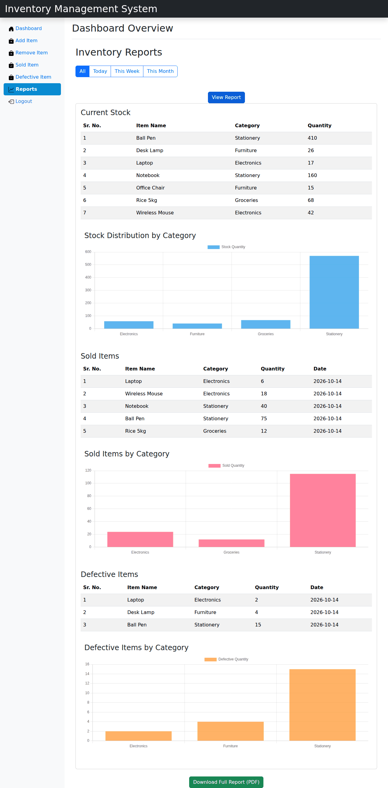

# IMS – Inventory Management System

A Django web app for tracking stock: add and remove items, record sales and defective items, and view or export inventory reports as PDF. Includes user signup and login.

## Features
- User signup, login and logout
- Add items with categories
- Remove items, mark items as sold or defective
- Transaction history for every stock change
- Inventory report with charts and PDF export
- Django admin panel

## Tech stack
Python 3.12, Django 5.1, SQLite, Matplotlib, ReportLab

## Screenshots

### Home, signup and login
| Home | Signup | Login |
|---|---|---|
|  |  |  |

### Dashboard
Stock table plus charts of stock, sold and defective items by category.



### Add and remove items
| Add Item | Remove Item |
|---|---|
|  |  |

### Sold and defective items
| Sold Items | Defective Items |
|---|---|
|  |  |

### Inventory report (with PDF download)


## Setup

```bash
git clone <your-repo-url>
cd IMS

python -m venv venv
# Windows
venv\Scripts\activate
# Mac / Linux
source venv/bin/activate

pip install -r requirements.txt
python manage.py migrate
python manage.py createsuperuser
python manage.py runserver
```

Open http://127.0.0.1:8000/

| URL | Page |
|---|---|
| `/` | Home |
| `/signup/`, `/login/` | Authentication |
| `/inventory/` | Inventory dashboard (login required) |
| `/inventory/report/` | Inventory report |
| `/admin/` | Admin panel |

## Configuration
Optional environment variables (defaults are fine for local development):

| Variable | Default | Purpose |
|---|---|---|
| `DJANGO_SECRET_KEY` | insecure dev key | Set a long random value in production |
| `DJANGO_DEBUG` | `True` | Set to `False` in production |

Generate a secret key with:
```bash
python -c "from django.core.management.utils import get_random_secret_key as g; print(g())"
```

The SQLite database (`db.sqlite3`) is created locally by `migrate` and is not committed to git.

## Project structure
```
IMS/            Django project settings and root URLs
INVENTORY/      Main app: models, views, forms, templates
templates/      Home, login and signup pages
static/         Shared images
screenshots/    Images used in this README
```